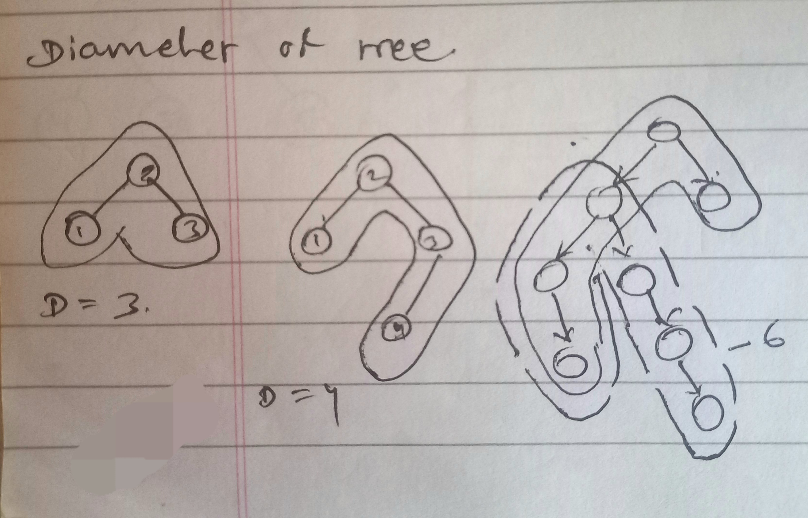

# Binary Trees

## 1. Height of Binary Tree
### i. Recursive Method Complexity
#### Time Complexity
- Each node is processed once: you compute its left height, right height, then return.
- Even though the call stack “returns” back to a node, that’s not a new visit — it’s just unwinding the stack.
- So total work = O(n), not more.

👉 Your doubt: “Aren’t we revisiting Node(3) when we return?”

- No — we don’t recompute Node(3). Its frame was already on the stack.
- Returning to Node(3) just means finishing its pending computation (combine left and right results).
- That’s why we count each node once.

#### Space Complexity
- At most, the stack depth = tree height h.
- In a skew tree, h = n, so worst case space = O(n).
- In a balanced tree, h ≈ log n.

### ii. Iterative Method Complexity
#### Time Complexity
- Each node is enqueued once and dequeued once.
- Work per node = O(1).
- Total = O(n).
- The nested while + for doesn’t make it O(n²) because the inner loop runs exactly once per node overall.

#### Space Complexity
- Queue holds nodes level by level.
- Worst case = maximum width of the tree.
- For a complete binary tree, width ≈ n/2 → O(n).
- For a skew tree, width = 1 → O(1).

## 2. Diameter of Binary Tree


### What is Diameter?
- Diameter = **longest path between any two nodes** in the tree.
- This path may or may not pass through the root.
- Think of it as “the maximum distance between two leaves.”
- Example:
    ```
          1
        /   \
       2     3
      / \   /
     4   5 6
    ```
- Longest path is `4 → 2 → 1 → 3 → 6`.
- Length = 5 nodes (or 4 edges, depending on definition).

### Code Breakdown
- op1 → the diameter of the left subtree.
- op2 → the diameter of the right subtree.
- op3 → the longest path that goes through the current node (left height + right height + 1).

👉 Why all three? Because the longest path might:
1. Lie completely in the left subtree.
2. Lie completely in the right subtree.
3. Pass through the current node (root of this subtree).

You need to check all three possibilities.

#### Why not just op3?

**The formula height(left) + height(right) + 1 (op3) captures the longest path through a given node, but it alone is not sufficient to guarantee the true diameter of the entire tree. The reason op1 and op2 are included is that the longest path may lie entirely inside a subtree and not pass through the current node.**

- The diameter is the maximum of three values — diameter of left subtree, diameter of right subtree, and height(left) + height(right) through the current node. This ensures correctness even when the longest path is deep inside one branch and doesn’t cross the root.

- A common mistake is assuming diameter always passes through the root. In skewed trees, the longest path lies entirely in one subtree. That’s why we must compare subtree diameters (op1/op2) with the path through the node (op3).

- The recursion must track both depth (for op3) and subtree diameters (op1/op2). The “two‑quantity post‑order” pattern is the standard way to solve diameter correctly.

#### Example
```
            1
           / \
          2   3
         / \
        4   5
       /     \
      6       7
     /       /
    11       8
             \
              9
               \
                10

```
- In this example, The longest path is indeed
11 → 6 → 4 → 2 → 5 → 7 → 8 → 9 → 10 → total **9 nodes**. This path lies entirely inside the left subtree, not through the root 1.
- The longest path lies entirely inside the left subtree, not through the root 1.
- If we only use op3 then, 
    - At root 1:
        - height(left) = 6
        - height(right) = 1
        - op3 = 6 + 1 + 1 = 8

    That looks large, but the actual longest path (diameter) is inside the left subtree, not crossing 1. [with op3 we got 8 but actual longest path is of 9 nodes]
    If you compute op3 only at 1, you’ll miss that the left subtree itself has a longer internal path that doesn’t involve 1.
    That’s why we must also compute: op1 and op2.
- At Node(2), it'll get `op1 = 3`, `op2 = 5` and `op3 = 3 + 5 + 1 = 9`.
- `op1` was the diameter from left subtree and `op2` was diameter from right subtree.
- `op3` is diameter by including root. Means diameter forming through root. That's why it joined both left and right subtree and added 1 (for root).
- If we had just reliead on height1 + height2 + 1 on root element only then it won't able to give answer `9` because height of left subtree is just `6`.
⁡
## 3. Balanced Tree
**A binary tree is balanced if, for every node, the difference in height between its left and right subtrees is at most 1.**

Formally: `height(left) - height(right) <= 1`

- **0 difference** → perfectly symmetric at that node.

- **1 difference** → still balanced (slight tilt allowed).

- **\>1 difference** → unbalanced.

Example:

```
            1
           / \
          2   3
         / \
        4   5
```
- Height(left) = 2, Height(right) = 1 → difference = 1 → ✅ balanced.

### Why abs?
`abs()` = absolute value.
We use it because the difference could be negative (e.g., left taller than right).
We only care about the magnitude of the difference, not the sign.

Example:

- Left height = 4, Right height = 2 → difference = 2.

- Without abs, you’d get -2, which doesn’t make sense for comparison.

- With abs, you get 2, which correctly shows imbalance.

### Why diff works with <= 1
`bool diff = abs(height(root->left) - height(root->right)) <= 1;`

- This is a boolean expression, not a number.

- If the difference ≤ 1 → diff = true.

- If the difference > 1 → diff = false.

So don’t confuse it with integers. diff is already true or false.

### Why check left && right && diff
Even if the root’s difference is fine, the tree could still be unbalanced deeper down.
That’s why we combine:

- **left** → is the left subtree balanced?

- **right** → is the right subtree balanced?

- **diff** → is the current node balanced?

Only if all three are true, the whole tree is balanced.

### Example of imbalance in a subtree
```
            1
           / \
          2   3
         /      \
        4        6
       /
      5
```

- At root (1): left height = 3, right height = 2 → difference = 1 → ✅ balanced.

- But at node (2): left height = 2, right height = 0 → difference = 2 → ❌ unbalanced.

So imbalance can occur inside a subtree, not just at the root.


## Time & Space Complexity of Diameter and Balanced Tree Problem

### Time Complexity

- isBalanced() traverses every node in the tree $\rightarrow$ visits $n$ nodes.
- At every single node, it calls height().
- Calling height() on a subtree is not $O(1)$; it walks down the subtree to count depth.

Because of this nested call to height() inside every step of isBalanced():

1. Skewed Tree ($h = n$)
    - At the root, height() visits $n-1$ nodes.- At the 2nd node, height() visits $n-2$ nodes.
    - At the 3rd node, height() visits $n-3$ nodes
    - ....
    - Total Time: $(n-1) + (n-2) + \dots + 1 = \mathbf{O(n^2)}$.
    
2. Balanced Tree ($h \approx \log n$)
- At level 0 (root): height() checks $n$ nodes $\rightarrow n$ work.
- At level 1 (2 nodes): height() checks $n/2 + n/2$ nodes $\rightarrow n$ work.
- At each level, the total work of all height() calls sums to $O(n)$.
- There are $\log n$ levels.
- Total Time: $n \times \log n = \mathbf{O(n \log n)}$.

**Overall Time Complexity**:$$\mathbf{O(n \cdot h)}$$(Worst case $O(n^2)$, Best/Balanced case $O(n \log n)$).

### Space Complexity
Suppose the tree has height $h$, and we are at node $X$ at depth $d$ (where $d \le h$):

1. isBalanced() is on the call stack at depth $d$.
2. Now, from node $X$, height() is called.
3. height() starts adding its own stack frames on top of the existing isBalanced() stack.
4. How deep can height() go from node $X$? Down to the deepest leaf below $X$, which is at most $(h - d)$ levels deeper!
5. So, total depth on the stack at that moment:$$\text{Current Depth of isBalanced} + \text{Depth of height} = d + (h - d) = h$$
6. Once height() finishes, its frames are popped and destroyed, freeing the memory before isBalanced continues.

At no point does the call stack ever exceed the total height of the tree $h$.

Therefore, the Auxiliary Space Complexity is simply:$$\mathbf{O(h)}$$
- Skewed Tree: $\mathbf{O(n)}$
- Balanced Tree: $\mathbf{O(\log n)}$

1. boundary traversal approach
    

    here, red part is leaf nodes
    orange is left part and yellow is right part (reverse order)

2. vertical order traversal
    

3. lowest common ancestor
    
    here, 5 is the lowest common ancestor of node 8 and node 27.

4. k sum paths
    

5. build tree from inorder and preorder
    
