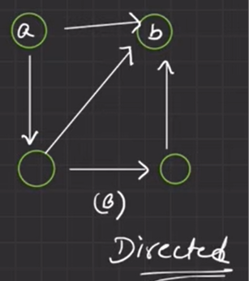
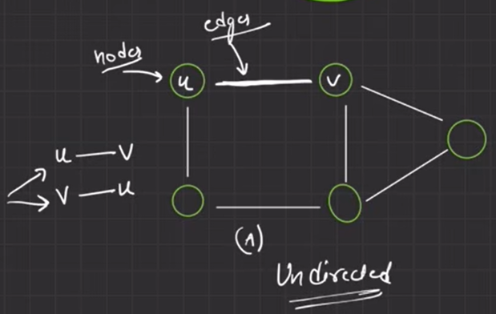
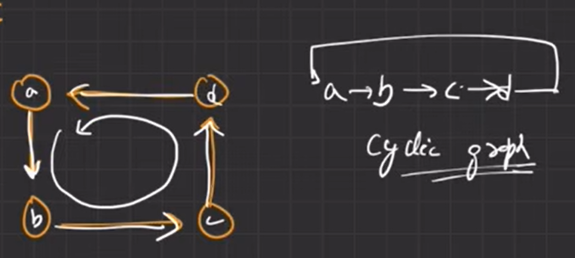
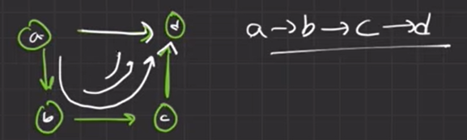
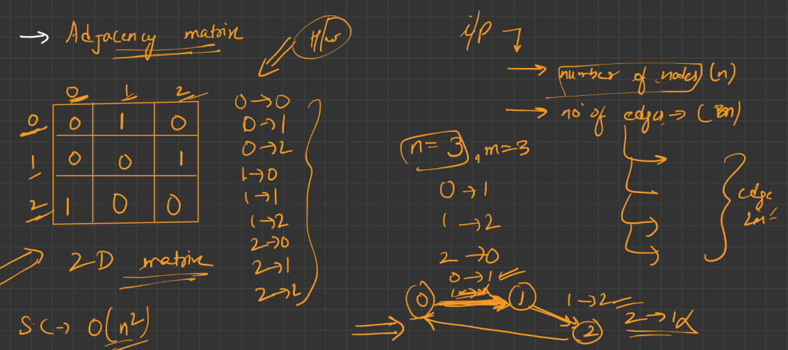
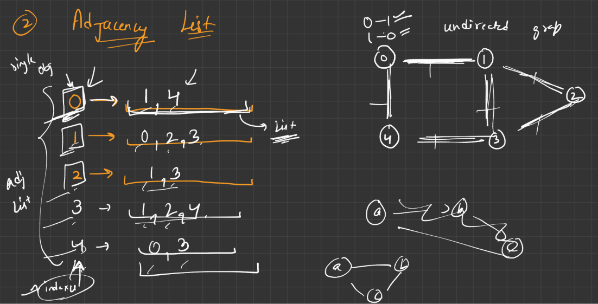

# Graph

## What is Graph?

Graph is a type of data structure which is a combination of nodes and edges.


## Types of Graph

### 1. Directed Graph: 

    

    Here, you can say that there's an edge between A to B but you can't say that it's between B to A. Because it's directed from A to B.

### 2. Undirected Graph:

    

    In between U and V there's no direction that's why we can say that there's an edge between U to V (U - V) and also have edge between V to U (V - U)


## Graph Terminologies

1. **Node**: It's an entity in which you can store any data.

2. **Edge**: It's a connection between nodes.

3. **Degree**: It means,
    
    - For Undirected Graph: 'how many numbers of edges connected to a node?' Example: Node(V) has 3 edges connected to it. Therefore, Degree(V) = 3.

    - For Directed Graph: It has two types of Degrees - 
        - (1) **Indegree**: How many edges are comming to the node? (directed towards that node). Example: Indegree(B) = 3.
        
        - (2) **Outdegree**: How many edges are going out from the node? (directed outwards from that node). Example: Outdegree(B) = 0; Outdegree(A) = 2.

4. **Weighted Graph**: Edge has its own weight.

    ```
             2                    2
        A ------- C          A ------> C
        |         |          |         |
      3 |         | 5      3 |         | 5
        |         |          v         v
        B ------- D          B ------> D
             7                    7
    Weighted Undirected    Weighted Directed
    ```

    Here, weight between (A to C) = 2; (A to B) = 3; (B to D) = 7; (C to D) = 5

    - If there's an undirected graph without any weights then you can assume, all edges have weight 1.

    - If there's a directed graph with weights you can call it '**Weighted Directed Graph**'.

    - If there's an undirected graph with weights you can call it '**Weighted Undirected Graph**'.

5. **Path**: Path is a sequence of travelled nodes where each node come only once.

    ```
        A ------- C 
        |         |  \ 
        |         |   P 
        |         |  /  
        B ------- D 
    ```

    Example: (A -> C -> P); (P -> D -> C); are valid paths. But, (P -> D -> C -> P) is not a valid path.

6. **Cyclic Graph**: In a graph, if you can reach to a node which you've already travelled then it's a cyclic graph.

    

    Here, A -> B -> C -> D -> A forming a continuous cycle.

    - If it's a directed graph then '**Cyclic Directed Graph**.
    - If it's weighted directed graph then 'Weighted **Cyclic Directed Graph**'

7. **Acyclic Graph**: It don't have any cyclic connection in the graph.

    

    Here, A -> B -> C -> D and it's not again connecting to A. So, cycle not formed.


## Graph Representations:

### 1. Adjacency Matrix:
    
    - We'll get number of nodes, edges in the input and a list of node mapping.
    
    - We represent this data in a 2D matrix.

    

    We can make this matrix by using nested for loops.

### 2. Adjacency List:

    - We'll get number of nodes, edges in the input and a list of node mapping.

    

---

## Complexity Analysis Of Graph Creation

### 1. Complexity of `addEdge()`

- Time Complexity: $O(1)$ on average, $O(V)$ worst-case.

- `adj[startNode]` performs a hash table lookup in unordered_map. 

- On average, bucket lookup is $O(1)$. 

- In the worst-case (severe hash collisions or rehashing), it can be $O(V)$ where $V$ is the number of vertices.

- `.push_back()` on a `std::vector` is amortized $O(1)$. Therefore, adding a single edge takes $O(1)$ amortized time.

---

### 2. Complexity of `printAdjList()`

Your intuition about nested loops often meaning $O(V^2)$ is common, but here it is actually $O(V + E)$.

Let:

- $V$ = number of unique vertices (keys in the map)

- $E$ = total number of edges

Here is why:

- The outer loop runs once for each unique node in the map: $V$ times.

- The inner loop does not run $V$ times for every node. It only iterates through that specific node's direct neighbors. Across the entire execution of the outer loop, the inner loop visits every edge stored:

    - In a directed graph, the sum of all neighbor list lengths is exactly $E$.
    
    - In an undirected graph, each edge is stored twice, so the sum of lengths is $2E$.
    
- Total steps = (outer loop iterations) + (total inner loop iterations across all nodes) = $V + 2E \rightarrow \mathbf{O(V + E)}$.

**Auxiliary Space Complexity of** `printAdjList`:

- **With &: $O(1)$ auxiliary space**. No copies of vectors or pairs are allocated.

- **Without &** (instructor's code): It creates a temporary copy of each vector `i.second`. The maximum memory consumed at any single moment is the size of the largest neighbor list: $O(\text{max\_degree})$, which can be up to $O(V)$ extra heap memory during each iteration.

---

###  3. Overall Time & Space Complexity of the Graph

- **Total Space Complexity**: $O(V + E)$

    - The unordered_map stores $V$ keys and internal bucket pointers: $O(V)$.
    
    - The vectors across all nodes hold all directed/undirected edge entries: $O(E)$.
    
    - Total memory in RAM: $O(V + E)$.
    
- **Total Construction Time**: For $E$ total edges, calling addEdge $E$ times takes $O(E)$ average time.


